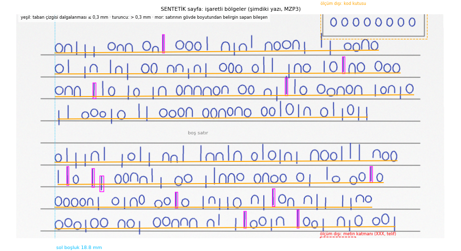

# El yazısı uzman raporu: tasarım ve sentetik örnek

Tarih: 2026-11-25. Rapor, uzmanın değerlendirmesini **destekleyen** açıklanabilir bir ölçüm özetidir: tanı, risk skoru, okunabilirlik yargısı ya da "iyi/kötü" etiketi içermez.
Aşağıdaki örnek **tamamen sentetik** (gerçek öğrenci, gerçek referans yok): `python -m src.handwriting.example_report`.
Dosyalar: `docs/el_yazisi_ornek_rapor/ornek_rapor.md` (metin), `ornek_rapor.json` (makine okunur), `isaretli_bolgeler.png`, `onceki_yazi.png`, `yapay_referans.csv`.
Kod: `src/handwriting/report.py` (rapor), `viz.annotate_regions` (işaretli bölgeler).

## 1. Raporun bölümleri

| Bölüm | İçerik | Tasarım kararı |
|---|---|---|
| Bağlam | Sınıf, görev (Bericht/Argumentation), ölçüm zamanı (MZP1–3), referans grubu ve büyüklüğü | Referans grubu yoksa ya da < 100 ise yüzdelik/uç işareti verilmez ("grup küçük"), çizim modülüyle aynı kural |
| 1. Ölçülen geometrik özellikler | 9 ölçüm: yazı boyutu, boyut tutarlılığı, bileşen boyut dağılımı, satır hizası değişkenliği, taban çizgisi dalgalanması ve eğimi, sol boşluk, kullanılan satır oranı, satır doluluğu. Değer + birim (mm) | `ink_density` raporda yok (kalem kalınlığına bağlı); kelime aralığı ve okunabilirlik yok (kapsam dışı) |
| 2. Referans karşılaştırması | "Bu çalışma örnekleminde (sınıf x görev x zaman) akranların X. yüzdeliği"; uçlarda (%5) "ölçümü ve görüntüyü kontrol edin" | Uç bölge bir değerlendirme değil, kontrol işaretidir. "Normal/anormal" dili yok. Popülasyon normu değil |
| 3. Görüntü üzerinde işaretli bölgeler | Taban çizgisi dalgalanmasına göre renkli çizgiler (> 0,3 mm turuncu), satırının gövde boyutundan belirgin sapan bileşenler (mor kutu), sol kenar boşluğu, atlanan satırlar, ölçüm dışı bırakılan alanlar (kod kutusu, metin katmanı) | İşaretler "uzmanın bakacağı yer"dir, hata/bozukluk işareti değildir |
| 4. Uzmanın inceleyebileceği özellikler | Her ölçüm için "ne ölçer / yorumlanırken dikkat edilecek sınır" (bkz. `docs/el_yazisi_bilimsel_temel.md`); işaretli bölge listesi; satır bazlı tablo (JSON'da `lines`) | Uzman kendi ölçeğiyle değerlendirir; BHK/ETCH puanı üretilmez |
| 5. Önceki yazıya göre değişim | Aynı öğrencinin önceki örneğiyle (aynı görev türü) değerler yan yana | **Güvenilir değişim eşiği tanımlı değilse fark yorumlanmaz** ("eşik tanımsız"); eşik gerçek veriden (aynı öğrencinin sayfaları arası değişkenlik) kurulacak; örnekteki iki eşik DEMO değeridir |
| 6. Ölçüm güvenilirliği | yüksek / orta / düşük + nedenler (çözünürlük < 150 dpi, çizgi bulunamadı, çizgi aralığı sapması, eksik çizgi tamamlama, kod kutusu bulunamadı, kalem rengi ayırt edilemedi, büyük eğiklik, son satıra taşma) | Taslak eşikler; pilotta gözleme göre ayarlanır |
| 7. Sınırlamalar | Sabit metin: statik ürün, motor beceri/hız değil; BHK eşdeğeri değil; referans = örneklem; uç bölge = kontrol işareti; tarama koşulları | Her raporda aynı, kişiye göre değişmez (çizim modülü ilkesi) |

Rapor **tek bir birleşik skor üretmez**; modüller arası birleşik skor da yoktur (proje ilkesi).

## 2. Örnek (sentetik) çıktı

Aşağıdaki tablo `ornek_rapor.md`'den alınmıştır (SENTETİK sayfa, YAPAY referans; sayılar bilimsel anlam taşımaz):

| Ölçüm | Değer | Referans yüzdeliği | Not |
|---|---|---|---|
| Yazı boyutu (gövde yüksekliği) | 4,66 mm | > referansın en büyüğü | uç bölge: ölçümü ve görüntüyü kontrol edin |
| Boyut tutarlılığı (satırlar arası) | 0,03 CV | 17. | |
| Satır hizası değişkenliği | 0,28 mm | > referansın en büyüğü | uç bölge: ölçümü ve görüntüyü kontrol edin |
| Taban çizgisi dalgalanması (satır içi) | 0,65 mm | > referansın en büyüğü | uç bölge: ölçümü ve görüntüyü kontrol edin |
| Taban çizgisi eğimi | −0,32° | 7. | |
| Sol kenar boşluğu | 18,80 mm | 14. | |
| Satır doluluğu | 0,84 | 95. | |

Önceki yazıya göre değişim (örnek): yazı boyutu 3,85 → 4,66 mm ("güvenilir değişim eşiğini aşıyor", DEMO eşiği 0,4 mm), diğer ölçümlerde "eşik tanımsız: fark yorumlanmaz".

İşaretli bölgeler (sentetik): `docs/el_yazisi_ornek_rapor/isaretli_bolgeler.png`, önceki yazı: `onceki_yazi.png`.

## 3. Gerçek veriyle raporun olgunlaşması (öncelik sırası)
1. Pilotta (gerçek 20 öğrenci) hangi ölçümlerin güvenilir olduğunu gör; güvenilmeyenler rapordan çıkar ya da "ölçülemedi" olur.
2. Referanslar (sınıf x görev x zaman, train) gerçek özelliklerle kurulur; `MIN_GROUP` ve %5 kuralı aynen.
3. Güvenilir değişim eşikleri kurulur; o zamana kadar değişim bölümü değerleri yan yana gösterir, yorumlamaz.
4. Çizim modülü raporundaki JSON sözleşmesiyle uyum (ortak sözleşme planı `docs/durum.md`'de bekliyor); örnek JSON geçici.
5. Uzman geri bildirimi (aşama 8): bölümlerin anlaşılırlığı, "uç bölge" dilinin yanlış okunup okunmadığı, işaretli bölgelerin yararı.

## 4. Bu tasarımın dışında bıraktıkları
Okunabilirlik, disgrafi ya da risk dili; yaş/sınıf tahmini; kelime aralığı; harf biçimi; yazma hızı/basıncı; anomali puanı; transkript tabanlı ölçümler (gelecek çalışma).
